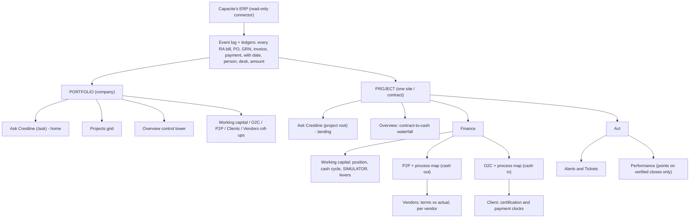
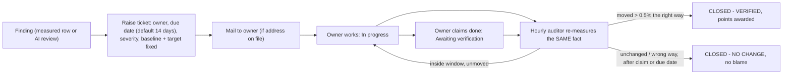

# How Crestline answers Capacite's five problems (SALES-17, 2026-10-06)

Purpose: the source document for the "how Crestline solves it" pages of the Project Keystone brochure for Rohit Katyal, Executive Chairman. Every Capacite figure is consolidated, INR Cr, 31 Mar 2026, and carries its source or its formula. Every saving is a **scenario computed with Crestline's own pure functions on public data, never a promise.**

Key: **V** verified in a primary filing (page given) · **C** computed by us (formula given) · **ERP** cannot be computed from public data; needs Capacite's own ERP event trail.
Sources: [R] audited results 20 May 2026 · [AR26] Annual Report FY26 (PDF page) · [IP] Q4 FY26 investor presentation · [T] Q4 FY26 call transcript (PDF page). Links: `docs/research/capacite-storyline.md` (SALES-13 table).
Calculator: `docs/brochure-capacite/solutions-calc/capacite-savings.ts` (run `npx tsx docs/brochure-capacite/solutions-calc/capacite-savings.ts` from the repo root). It imports `simulate`, `toTerms`, `leversFor` (`lib/finance/cycle-simulation.ts`), `valueOfADay` (`lib/finance/working-capital-cycle.ts`) and `priceLevers` (`lib/insights/levers.ts`) unchanged, and asserts that the app's two bounds (DPO never past vendor terms, DSO never below the client's term) still hold on Capacite's numbers.

---

## 0. Assumptions behind every saving (rule 7: stated wherever a financing figure appears)

| # | Assumption | Basis |
|---|---|---|
| A1 | **Financing rate 9.65%.** Capacite's own rate on fund-based limits. | **V** [IP] slide 5: "reduce interest rate from ~12.5% to 9.65% for Fund Based Limits"; [T] PDF p.8: "interest cost over the last 15 months has come down from 12.65% to 9.65%". The client design's "9.65%" is therefore sourced. Note the two documents give different starting rates (~12.5% vs 12.65%); only 9.65% is used. |
| A2 | We did **not** use finance cost / average borrowings. | **C** 96.41 / ((471.77 + 416.66) / 2) = **21.7%**. Overstated as a borrowing rate: the line includes bank-guarantee commission and "advances on which interest is payable" [T] PDF p.8. 9.65% is the marginal rate a released rupee would stop paying, so it is the conservative and defensible choice. |
| A3 | **Value of one day** = revenue / 365 = 2,622.72 / 365 = **₹7.19 Cr** of cash; carry ₹0.69 Cr a year at 9.65%. | `valueOfADay(revenuePerDay, 9.65)`, the same function the WC screen uses. Revenue **V** [R] p.9. |
| A4 | Days are on **closing balances, 365-day year**, consolidated. | The app uses average balances where an opening figure exists (`ratios.basis`); FY26 public data would allow it, but the brochure's day figures (163.8, 182.8, 179.2) are closing and Capacite's own "Debtors Turnover 164 days" [AR26] PDF p.95 matches that basis. |
| A5 | **Receivables carry GST; revenue does not.** Receivable days on public data mix bases. | The app measures the factor from the ledger against the invoice trail (`measureBasisFactor`, `lib/derive/reconcile.ts`) and restates before dividing. Public data cannot measure it. **ERP.** |
| A6 | **Receivables include retention and unbilled work awaiting certification** by Capacite's policy. | **V** [AR26] PDF p.148. So no scenario can treat the whole ₹1,176.8 Cr as collectable within the 45-90 day term. |
| A7 | "Carry saved" is **annual and recurring for as long as the improvement holds**; "cash" is one-off. They are never added together. | `simulate()`: `carry = released × ratePct / 100`. |
| A8 | Scenarios **overlap and are not additive across problems.** P3's aged money sits inside P2's receivables; the 90-day target (b) is a company total covering P1 + P2 + P5. | Stated on every table. |

---

## 1. The product, end to end

### 1.1 Hierarchy

Three pillars: **O2C** (cash in), **P2P** (cash out), **Working capital** (the money trapped between them). The scope is in the URL: a portfolio number and a project number can never be confused on one screen.

### 1.2 The intelligence layer: TIME x MONEY

Every finding is priced in rupees, measured in days, owned by a named desk, and ranked by **rupee-days** (amount x excess days), never by case count (product rules 3 and 4).

---

## 2. The process map: what it is, and what the brochure may honestly show

**What exists in the code (checked, branch `clientui`, commit 5b80121):**
- The engine `lib/process-mining/discover.ts` is pure and deterministic: same event log, same map, byte for byte.
- The standalone Process Map **tab** is gone (CLAUDE.md), but the canvas is **not**: `ProcessGraph` (`components/process-map/process-graph.tsx`) is still mounted on every project's **O2C page** (`app/(app)/projects/[id]/o2c/page.tsx:434`, "The O2C Process, As The Event Log Recorded It") and **P2P page** (`app/(app)/projects/[id]/p2p/page.tsx:184`). O2C and P2P are discovered separately, never merged. CLAUDE.md's "the canvas was removed" is true of the tab only; flag for the docs owner.
- What one map shows: every step a bill or order really went through; each step card carries wait, cash and owner; Steps and Routes sliders move from the trunk to the full "spaghetti"; rework loops (a bill rejected and resubmitted is the SAME step twice, so loops are visible); `holders` = cases sitting on a step right now, with their age and value.
- Bottlenecks are **ranked by money, not duration** ("a four-day wait on ₹40 Cr beats a three-week wait on ₹40 L"), and each carries `internallyControllable`: **ours to fix** vs **needs the client / vendor**. A wait belongs to whoever makes the act that ends it: a wait ending in "certified" or "collected" is the client's; a wait ending in our submission is ours.

**What the brochure process map can honestly be:**
1. **A schematic of Capacite's own O2C stages with the days left blank** (dashed boxes): Work executed → Measured → QS checked → RA bill prepared → Internal review → Submitted → Client acknowledged → Certified → Invoiced → Collected, with a rework loop drawn from "Rejected" back to "Prepared". These are the stage fields Crestline rebuilds every RA bill from (`lib/derive/cases.ts`: `executedAt … collectedAt`, `reviewRounds`). Labels "ours" / "client's" on each wait are legitimate because they follow the rule above, not Capacite data.
2. **Or a screenshot of the real map on the demo ledger (Grey Infra)**, labelled "Demo data. Your map is drawn from your own ERP in the pilot." Never captioned with Capacite names or figures.
3. **Not**: a map with Capacite days, bottlenecks or names. We have no Capacite event log, so any such figure would be invented. (Company-level days of 182.8 / 163.8 may annotate the two ends of the schematic as **C** figures, because they come from the balance sheet, not from the map.)

---

## 3. The five problems: what, why, how, where, what it is worth

Common per-day figures (**C**, A3, A4): revenue ₹7.186 Cr/day; material consumed ₹2.258 Cr/day (824.27 / 365, pack s.2); vendor cost base ₹5.078 Cr/day (1,853.5 / 365, pack s.2).
Opening position through `simulate()`: DIO 57.1 · contract-asset days 182.8 · DSO 163.8 · DPO 179.2 · cash gap incl. unbilled 224.5 days · WC (receivables + contract assets + inventory − payables) ₹1,709.3 Cr. All **C**.

### P1. Work done, not billed: ₹1,313.5 Cr, 182.8 days

- **What we solve.** Which RA bills and work orders make up the ₹1,313.5 Cr (**V** [R] p.10: 1,068.34 current + 245.15 non-current), how long each sat at measurement, QS check, internal review and client certification, and whose desk holds it today.
- **Why it matters.** 182.8 days of revenue (**C** 1,313.49 / 2,622.72 × 365). Every day of it is ₹7.19 Cr of cash and ₹0.69 Cr a year of interest at 9.65%. It is the largest single block on the balance sheet, and the **only one of the five that is mostly ours to move**: measurement, QS and submission are internal desks.
- **How Crestline solves it.**
  - *Engine:* each RA bill is rebuilt from its events; stage waits are split into **ours** (executed → submitted) and **the client's** (submitted → certified). Rework rounds (bills sent back) are counted per bill with the client's own reason.
  - *Screens:* project **Overview** (contract-to-cash waterfall: where value stops becoming cash; value-state map that sums to the contract), **O2C** (process map + stage waits), **Working capital** simulator lever "Built, waiting to be certified", floored at **the certification window in that contract**.
  - *Action:* the playbook lists the named bills past their certification window with a deadline each; one click raises a ticket to the QS / billing desk.
- **Solution visual for the brochure.** The P1 stage timeline, with a second, lighter bar beneath the "work done → billed" span labelled "a 10-day shorter queue, illustrative: ₹71.9 Cr". Same axis, same scale (Lesson DEV-1b). Days inside the stages stay dashed: ERP.
- **What it is worth** (formula: days removed × ₹7.186 Cr; carry = cash × 9.65%):

| Scenario | Days | Cash released (one-off) | Interest saved / year | Status |
|---|---|---|---|---|
| (a) to each contract's certification window | ? | NA | NA | **ERP**: windows are per contract and not public. The app floors this lever at that window; with none it cannot be set honestly |
| (b) own target | part of 152 → 90 | see P4 | see P4 | company total, not per leg |
| (c) conservative step | −10 | **₹71.9 Cr** | **₹6.9 Cr** | **C**, `simulate({cad: 172.8})` |
| (c) stretch step | −30 | **₹215.6 Cr** | **₹20.8 Cr** | **C** |

- **Stays the counterparty's.** The client's time from submission to certification. Crestline names it, ages it against the agreed window and drafts the chase; it cannot certify for MHADA or CIDCO.
- **Needs the ERP.** Why ₹245.15 Cr moved to non-current in FY26 (reason not disclosed, **V** [R] p.10); contract-asset ageing (not published).

### P2. Bills raised, not paid: ₹1,176.8 Cr, +164% since FY23 against revenue +46%

- **What we solve.** Splits the one receivable figure into **retention**, **certified awaiting payment**, and **disputed**, by client, site and invoice, each aged against **its own due date** (never a house average: one client on 45 days and another on 90 must not both be "late").
- **Why it matters.** 163.8 days (**C** 1,176.81 / 2,622.72 × 365; Capacite's own figure 164, **V** [AR26] PDF p.95). Receivables grew 3.6x faster than revenue (**C** 1,177 / 445 vs 2,623 / 1,799, [IP] slide 28). Terms are "generally 45 to 90 days" (**V** [AR26] PDF p.158).
- **How Crestline solves it.**
  - *Screens:* project **O2C** (bucket grid, ageing in rupee-days, process map of the bill), **Client** (the client's two clocks: certification and payment, against the contract), portfolio **Clients** (which client is slowest across all sites).
  - *Simulator lever* "Invoiced, waiting to be paid": **floored at the payment term this client signed** (rule 2: "the client's clock is not ours"). Marked **theirs**, not ours.
  - *Daily client statement* (`app/api/cron/client-reminders`): what falls due in five days, what is due today, what is overdue, which bills are past their certification window. Sends nothing unless `CLIENT_AUTO_MAIL=on`.
- **Solution visual.** The P2 indexed-lines chart (FY23 = 100: revenue 146, receivables 264) with one dashed "receivables if days had held at FY23's 90.3" line (**C** 90.3 × 2,622.72 / 365 = ₹649 Cr in FY26 terms). Labelled "illustrative", same index axis.
- **What it is worth:**

| Scenario | Days | Cash | Interest / year | Status |
|---|---|---|---|---|
| (a) to the 90-day term (top of 45-90) | 163.8 → 90 | ≤ **₹530.1 Cr** | ≤ **₹51.2 Cr** | **C**, `simulate(toTerms)`. **Upper bound, not reachable as stated**: retention is inside receivables (A6) and is not due within 90 days; GST inside the balance (A5) |
| (a′) to 45 days | 163.8 → 45 | ₹853.5 Cr | ₹82.4 Cr | do not print: the app only floors at 45 where the contract says 45 |
| (c) conservative | −10 | **₹71.9 Cr** | **₹6.9 Cr** | **C**; matches pack s.2 "10 days of DSO = ₹71.9 Cr" |
| (c) stretch | −30 | **₹215.6 Cr** | **₹20.8 Cr** | **C** |

- **Stays the counterparty's.** Paying. Crestline ranks the chase by rupee-days and says who on our side owns it; the money moves when the client pays.

### P3. The old money is getting older: > 6 months ₹90.4 → ₹128.2 Cr

- **What we solve.** Names every aged bill: client, project, since which date it stalled, at which step (certified and unpaid, disputed, in legal), and who last acted on it. Public ageing stops at one table measured from transaction date (**V** [AR26] PDF p.158).
- **Why it matters.** > 6 months ₹128.18 Cr, 10.8% (**C** 43.94 + 45.69 + 14.56 + 23.99) vs ₹90.43 Cr, 7.9%; 1-2 years 17.93 → 45.69; disputed ₹41.21 Cr. Auditor: qualified opinion on ₹11.56 Cr (one party, re-admitted to CIRP) and emphasis of matter on ₹54.93 Cr, both with legal action under way (**V** [R] p.5, [AR26] PDF p.97, p.140). Impairment charged ₹57.93 Cr in FY26 (**V** [AR26] PDF p.158).
- **How Crestline solves it.** O2C ageing priced in rupee-days (₹ × days past each bill's own due date), so a ₹5 Cr bill two years late outranks forty small ones; every row opens the documents with their dated trail (`EvidenceProvider`); each aged bill can become a ticket with a deadline, and the auditor re-measures the same receivable figure. Disputed and legal items are labelled as the counterparty's, never put on a collector's action list as "fix".
- **Solution visual.** The P3 two-column ageing stack (Mar 2025, Mar 2026) with a third, outlined column "with the 1-2 year band back at FY25" (illustrative), same scale.
- **What it is worth** (cash = rupees recovered; interest at 9.65%):

| Scenario | Cash | Interest / year | Status |
|---|---|---|---|
| (a) everything past terms (all > 6 months is past a 45-90 day term) | ≤ ₹128.2 Cr | ≤ ₹12.4 Cr | **C**, upper bound: includes ₹41.21 Cr disputed and the auditor items in legal process |
| (b-like) > 6 months back to FY25's level | ₹37.8 Cr | ₹3.6 Cr | **C** 128.18 − 90.43 |
| (c) recover 10% / 30% of > 6 months | ₹12.8 / ₹38.5 Cr | ₹1.2 / ₹3.7 Cr | **C** |

- **Stays the counterparty's / courts'.** The ₹11.56 Cr in CIRP and the ₹54.93 Cr under NCLT, High Court and RERA steps. Crestline tracks them; it does not speed a tribunal.
- **Overlap.** These rupees are inside P2's ₹1,176.8 Cr. Never add P3 to P2.

### P4. Growth funded by stuck cash: WC absorbed ₹1,376 Cr FY23-26; borrowings 326 → 472

- **What we solve.** Which projects absorbed the ₹1,376 Cr, in which months, and what peak facility the business actually needed (the trough of cumulative collections minus payments, not the year-end close).
- **Why it matters.** ₹1,376 Cr absorbed = 75% of operating profit before WC changes (**C**, [IP] slide 29). Borrowings ₹471.77 Cr, up from 416.66 (**V** [R] p.11). Finance cost ₹96.41 Cr (**V** [R] p.9). Their own target: "WC days of 90 over 2.5 years", from 152 (**V** [AR26] PDF p.96; definition not disclosed). The call adds "net working capital of 56 to 60 days" over 8 quarters (**V** [T] PDF p.8, different measure, not used).
- **How Crestline solves it.**
  - *Portfolio Working capital* (company cash command centre): position by project, "why did WC move" waterfall, project × ratio heatmap, release opportunity per project from each project's own simulator at agreed terms.
  - *Cash movement panel*: monthly collections vs payments and **peak funding need** (`lib/finance/cash-movement.ts`). Needs monthly cash in/out, so **ERP**; annual public figures cannot produce a trough.
  - *Levers ranked in one currency* (`priceLevers`): every move as cash once + carry a year, **ours vs theirs** never averaged; "Do this first" row; financing the gap is priced as the alternative every lever beats.
- **Solution visual.** The P4 waterfall (1,839 → (1,376) → (136) → 324) with one outlined bar beside the WC bar: "at 90 WC days, FY27's growth alone needs ₹89 Cr less". Or a two-bar "FY27 extra working capital at 20% growth: ₹218 Cr at 152 days vs ₹129 Cr at 90 days".
- **What it is worth:**

| Scenario | Cash | Interest / year | Status |
|---|---|---|---|
| (b) their own target, 152 → 90 WC days | **₹445.5 Cr** | **₹43.0 Cr** | **C** 62 × 7.186. Assumes WC days are measured on revenue; definition not disclosed. Equals 94% of gross borrowings (471.77) |
| (b) growth: FY27 at +20% revenue ([T] guidance) | **₹89.1 Cr** less new WC needed in FY27 | ₹8.6 Cr | **C** (152 − 90) × (3,147.3 − 2,622.7) / 365 |
| (c) P1 + P2 together, −10 days each | **₹143.7 Cr** | **₹13.9 Cr** | **C**, `simulate()`; cash gap 224.5 → 204.5 days |
| (c) P1 + P2 together, −30 days each | **₹431.1 Cr** | **₹41.6 Cr** | **C**; gap 224.5 → 164.5 days |

- **Caution for print.** The 90-day target holds only if vendor credit holds: the CFO says so himself ("considering that we maintain our creditor levels", [T] PDF p.8). See P5.

### P5. Vendors: payables ₹910 Cr, ~179 days, one average hides every vendor

- **What we solve.** Each vendor's payments against **its own due date**: who is paid early (capital leakage, `Σ amount × days early ÷ 365`), who is paid late (risk), MSME exposure against the statutory 45 days, by vendor and site. The vendors screen draws both clocks as a dumbbell per vendor.
- **Why it matters.** DPO 179.2 days (**C** 909.92 / 1,853.5 × 365; company basis not disclosed). MSME payables ₹45.66 Cr (**V** [R] p.11). Peers pay in 62-85 days (**C** pack s.5, directional).
- **How Crestline solves it.** Product rule 1: **DPO is never "higher is better"**. The simulator's vendor lever has a **ceiling at the vendors' own spend-weighted terms**; where terms are unknown it is held at today's figure. Tested on Capacite's numbers: asked for 250 days, `simulate()` holds DPO at 179.2 (asserted in the calculator). The levers row "Pay every vendor on their due date, not before" prices early payment only.
- **Solution visual.** The P5 peer bar, plus a blank dumbbell frame (terms vs actual, per vendor) captioned "drawn from your ERP in the pilot".
- **What it is worth.** **No cash is released by stretching vendors, and none is claimed.** The honest figures are the reverse:

| Sensitivity | Cash consumed | Interest / year | Status |
|---|---|---|---|
| Paying vendors 10 days sooner | ₹50.8 Cr | ₹4.9 Cr | **C** 10 × 5.078 |
| Paying at a peer's 83 days | ₹488.4 Cr | ₹47.1 Cr | **C** (179.2 − 83) × 5.078; shows how much of today's position vendors fund |
| Early-payment leakage, MSME late-payment exposure | ? | ? | **ERP**: needs each vendor's due date |

- **Stays the counterparty's.** Vendor terms are a negotiation. Crestline shows each vendor's agreed terms beside actual timing; it never recommends paying later than agreed.

---

## 4. Ask Crestline: what a chairman can ask

- **Where:** `/ask` (company, home screen) and each project's root (one job). Same screen, two scopes, scope in the URL.
- **Before a word is typed:** the morning brief, "what happened and what needs me", every row tagged O2C / P2P / Working capital, each with Actionables and a mail-the-owner button.
- **Questions it is built for, and what answers each** (`lib/ask/answer.ts`, `decide.ts`):

| Kind | Example for Capacite | Answered from |
|---|---|---|
| position | "How much is waiting to be certified at the CIDCO sites?" | retrieved facts, figures first |
| why | "Why is this project beyond its terms?" | every fact against its own contract target, ranked on the relative gap |
| what now | "What should I do first to release cash?" | `priceLevers` ranked, financing priced as the alternative, named invoices and deadlines from the playbook |
| what if | "What if MHADA paid in 60 days?" | `simulate()`, bounded by that contract's own windows; asks outside them are taken to the bound and told so |
| compare | "Which project is holding the most capital?" / "Compare Bhandup with the CIDCO site" | the benchmark table: gap to each project's OWN terms |
| projection | "Where will receivables be in three months?" | least-squares over 6-12 months with its own band; fewer than 6 months says so |

- **Rules that make it safe to put in front of a chairman:** figures stream first (verdict, bullets, chart, actions), prose last; **a model never produces a number** (every figure is computed in TypeScript); the narration is checked by `strayFigures` and **discarded** if it contains any number not in the evidence; retrieval is lexical over the screen's own facts, so the answer cannot disagree with the screen.

---

## 5. The simulator: levers, bounds, "make this the plan"

`CashCycleSwitch` on the working-capital card: **Position / Simulate**.

| Lever | Rate it moves at | Bound | Side |
|---|---|---|---|
| Stock on site | material issued per day | floor 0 | ours |
| Built, waiting to be certified | revenue per day | **floor = the contract's certification window** | ours |
| Invoiced, waiting to be paid | invoiced value per day | **floor = the client's payment term** | theirs |
| Vendor credit taken | the payable's cost base per day | **ceiling = vendors' spend-weighted terms** | theirs |

- A leg without a measured rate is disabled and says why (rule 3).
- **Make this the plan:** the scenario emits ordinary rows carrying the moved leg's fact (`wc.dso`, `wc.contractAssetDays`) with the simulated figure as the **target**; raising one writes that target into a ticket, so the plan closes only when the same figure is re-measured at the target.
- On Capacite's public numbers, only the 10/30-day steps can be run honestly; "to terms" for certification needs each contract's window (ERP).

---

## 6. Ticket lifecycle, step by step (`lib/orchestrator/tickets.ts`, `app/api/cron/orchestrator/route.ts`)

1. **Recorded.** A measured row is first stored as a finding (provider `crestline`, model `measured`), so the trail never claims a model said what arithmetic said. A row with no re-measurable figure raises nothing and says why.
2. **Raised.** The composer pre-fills title, numbered steps (named invoices, deadlines), owner (resolved from org unit and what the person actually does in the event log) and severity. The **baseline, target and "lower is better" are fixed at this moment**, so "improved" cannot be redefined later.
3. **Owner told.** Mail with baseline, target, due date and chasing cadence. No address: the ticket stands and the log says nothing was sent.
4. **Chased.** Severity is a cadence, not a label: Low 1, Medium 3, High 5 reminders a day, spaced across the day. Automated reminders send nothing unless `ORCHESTRATOR_AUTO_MAIL=on` (`?dry=1` previews).
5. **Worked.** Owner moves it to In progress; the drawer holds the discussion thread, the time in each stage and every reminder with whether it landed.
6. **Claimed.** Owner marks "awaiting verification". **No human can set it to done.**
7. **Audited.** The hourly pass rebuilds the module's evidence from the source and reads the one fact the ticket named. It skips (writes nothing) when no sync has finished since the last reading, nobody has claimed done, and the due date has not passed. "Audit now" always reads fresh.
8. **Closed on the number.** Moved materially (> 0.5%) the right way: **VERIFIED**, points scaled by the share moved, +25 for reaching target, +10 if it carried rupee impact. Unmoved or worse, but only after a claim or the due date: **CLOSED - NO CHANGE**, "a fact about the number, not a judgement of the effort". Never closed unmoved before the owner has had a chance.
9. **Steps aside.** Under the chart, the raised row moves to "Already raised" with no buttons; the AI is told and moves on to the next-best move.

## 7. Alert lifecycle, step by step

1. **Alert owner** (amber, on any row or brief line) first names the recipient and their address: these are real inboxes and a send cannot be recalled.
2. It **still writes a ticket** behind the mail (`mailOwnerFromInsight`): a mail with no commitment behind it is a to-do nobody can close.
3. The mail goes; the result (sent / not sent and why, in plain words) is logged on the ticket and appears in the bell feed and Alerts and Tickets → Activity.
4. From there it follows the ticket lifecycle (section 6). A plain "alert" without a mail (`raiseAlert`) marks the finding as flagged-without-ticket: no clock, no owner commitment, counted in its own chip.
5. A row that is already a ticket cannot raise a second one; its mail button pushes the existing ticket. Buttons are hidden below MEMBER role.
6. Counterparty side: the daily client statement (section P2) logs every reminder on that bill's ticket, so client chasing is auditable the same way.

---

## 8. One-screen summary

Cash = one-off release; interest = a year at 9.65% (A1). Rows overlap (A8): do not add the column.

| Problem | Crestline feature | Where | Conservative (−10 days / 10%) | Their own target / bound | Needs ERP |
|---|---|---|---|---|---|
| P1 Work done, not billed ₹1,313.5 Cr | RA-bill stage waits, ours vs client's; certification lever floored at contract window; named bills + tickets | Project Overview, O2C map, WC simulator | ₹71.9 Cr · ₹6.9 Cr/yr | (−30 days: ₹215.6 Cr · ₹20.8 Cr/yr) | windows per contract, stage days, ₹245 Cr non-current |
| P2 Bills not paid ₹1,176.8 Cr | Split retention / certified / disputed; ageing vs each bill's due date; client clocks; daily statement | O2C, Client, portfolio Clients | ₹71.9 Cr · ₹6.9 Cr/yr | to 90-day term ≤ ₹530.1 Cr · ₹51.2 Cr/yr (upper bound, retention inside) | retention split, GST factor, per-client terms |
| P3 Old money ₹128.2 Cr > 6 m | Rupee-day ageing, named bills, legal items marked counterparty's | O2C ageing, tickets | ₹12.8 Cr · ₹1.2 Cr/yr | back to FY25 level ₹37.8 Cr · ₹3.6 Cr/yr | client and project behind each aged rupee |
| P4 Growth funded by stuck cash | Portfolio WC, peak funding need, levers ranked in one currency, "make this the plan" | Portfolio Working capital, Overview, Ask | P1+P2 −10: ₹143.7 Cr · ₹13.9 Cr/yr | 152 → 90 days: ₹445.5 Cr · ₹43.0 Cr/yr; FY27 growth needs ₹89.1 Cr less | which projects absorbed ₹1,376 Cr; monthly trough |
| P5 Vendors ₹910 Cr, 179 days | Per-vendor terms vs actual; DPO capped at terms (rule 1); early-payment leakage | P2P, Vendors | no release claimed; paying 10 days sooner costs ₹50.8 Cr · ₹4.9 Cr/yr | — | each vendor's due date, MSME 45-day exposure |

**Print line under the table:** "Illustrative scenarios computed by Crestline's own working-capital arithmetic on Capacite's published FY26 consolidated figures, at the 9.65% fund-based rate Capacite reported. Not a forecast or a commitment; the pilot measures the real figure from your ERP."

## 9. Open items
- Definition of "WC days (152)" (A-row in storyline): ask Rajesh Das. All (b) figures assume a revenue denominator.
- Certification windows and vendor terms per contract: ERP. Until then, (a) for P1 and P5 is NA by design, not omission.
- CLAUDE.md says the process-map canvas was removed; the code still renders it on project O2C and P2P pages. Docs owner to reconcile.
